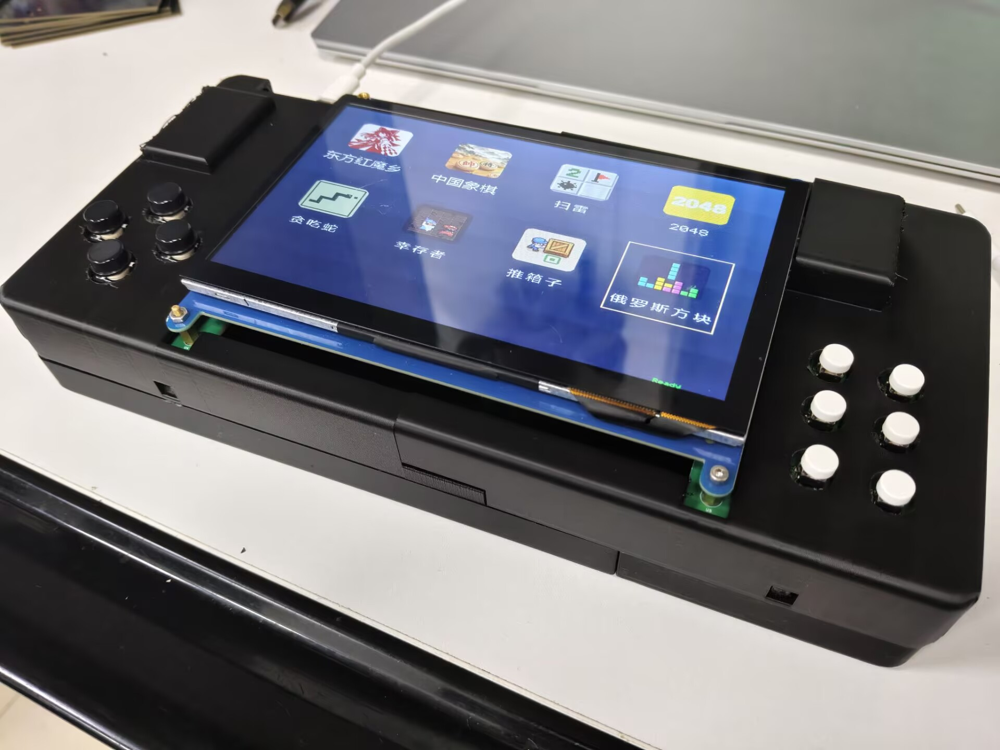

# 基于FPGA图形加速的游戏掌机

基于易灵思 Ti60F225 的二维图形渲染加速与八游戏掌机。RISC-V 软核负责游戏逻辑和绘制任务组织，FPGA完成像素搬运、透明色剔除及Alpha混合，输出640×480 HDMI画面。

## 提交资料

报告、海报、作品照片、开发板照片及承诺书保存在本仓库。体积较大的文件保存在 [v1.0.0 Release](https://github.com/ljb0806/fpga_ES_2026_submit/releases/tag/v1.0.0)：

| 附件 | 内容 | 大小 |
| --- | --- | --- |
| `Project.rar` | PL与PS工程、素材，以及outflow中的固化文件 | 31.2 MB |
| `参赛视频.mp4` | 作品组装、性能测试及游戏演示，约2分47秒 | 286.1 MB |
| `fpga_ES_2026_submit.zip` | 工程、视频、报告、海报等完整提交资料 | 327.2 MB |

仓库保持私人可见，Release附件同样需要仓库访问权限。

## 工程与固化文件

解压 `Project.rar` 后，工程文件直接位于根目录，PL入口为 `Ti60F225_tinyml_helloworld.xml`，PS程序位于 `embedded_sw`。三个交付产物集中保存在 `outflow`：

- `Ti60F225_tinyml_helloworld.bit`：PL配置文件。
- `Ti60F225_tinyml_helloworld.hex`：PL配置HEX。
- `带素材完整固化文件.hex`：包含PL、压缩PS程序和八款游戏素材的完整8MiB Flash镜像。

工程构建使用Efinity工具链；本地构建脚本中的工具安装路径需按实际环境设置。

## 游戏与测试

游戏包括东方红魔乡、中国象棋、扫雷、2048、贪吃蛇、地牢幸存者、推箱子和俄罗斯方块。东方红魔乡菜单还提供CPU与FPGA同屏渲染对比、Alpha精灵测试，以及8×8、16×16、32×32弹幕测试。各测试的具体条件与实测结果见技术报告。

Release发布说明列出附件的SHA-256校验值，可在下载后核对文件完整性。
